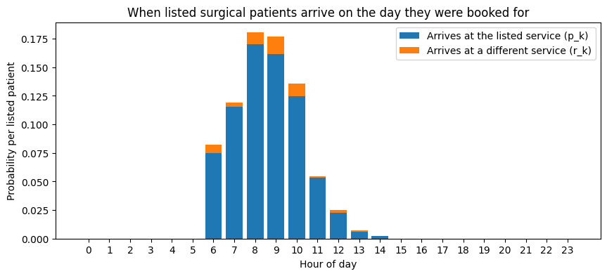
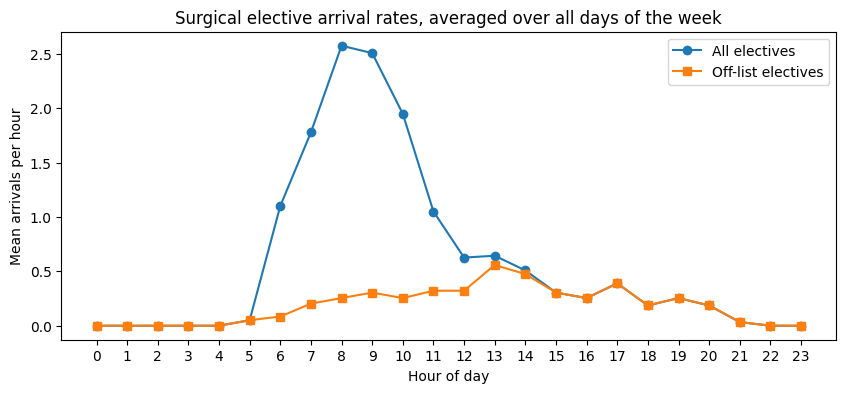
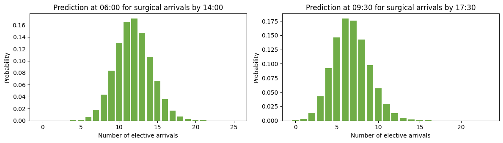
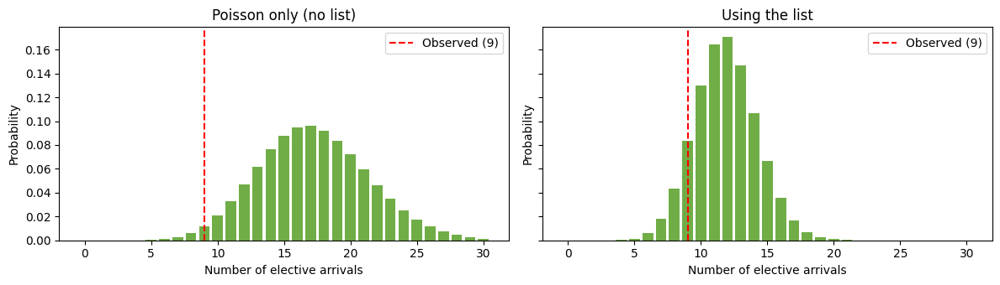

# 3g. Predict elective demand using a list of planned admissions

In notebook 3e I predicted demand from patients yet to arrive using past arrival rates alone. For elective admissions, that approach treats the number of patients who will come in today as uncertain. In practice, hospitals often know a good deal more than that. Planned admissions are recorded on a list some hours before the patients arrive, for example on a 'To Come In' (TCI) list, or as pending admission requests raised the afternoon before.

When a list like this is available, most of the uncertainty about how many electives will arrive is already resolved. What remains is:

- **Attrition.** Some listed patients do not arrive. They cancel, do not attend, are deferred to another day, or arrive at a different service from the one they were listed under.
- **Timing.** A listed patient who does arrive may do so before or after the prediction window.
- **Unlisted electives.** Some elective patients are never on the list.

In this notebook I show how to use the `ListBasedAdmissionPredictor` class to condition the prediction on the list. The predicted count has two independent parts:

- **Listed patients still to arrive.** Each pending patient arrives in the window with probability `q`, or does not, so the number arriving is binomial. (In general this is a Poisson-binomial, because `q` could differ between patients. In this version `q` is estimated per service, so within a service it is a plain binomial.)
- **Off-list arrivals.** Electives who were not on that day's list for that service are modelled with a Poisson distribution, as in notebook 3e. I call these _off-list_ electives. They include patients who were never listed, and also patients who were listed for another day or under another service.

The two distributions are convolved to give the prediction.

A note on identifiers. In notebook 3e I said that the hospital visit for an elective procedure may not be recorded in data before the patient arrives. Where a list of planned admissions exists, the visit identifier (here called `encounter`) is often created when the patient is listed, before they arrive. That is what makes it possible to match the list to later arrivals, and to drop listed patients from the list once they have arrived.

```python
# Reload functions every time
%load_ext autoreload
%autoreload 2
```

## Generate fake data

I use the `create_fake_elective_lists` function to generate three months of fake data, from January to March 2023, for three services:

- `surgical` has a large list on weekdays and a small one at weekends.
- `paediatric` has a very short list, too short to estimate list probabilities reliably.
- `haem/onc` has no list at all. All its electives are unlisted.

Each listed patient has one outcome. They arrive at the listed service on the day, arrive at a different service on the day, arrive the evening before, are deferred to the next day, or do not arrive. Unlisted electives also arrive at every service.

The function returns two dataframes. `elective_arrivals` has one row per elective arrival, and `elective_list` has one row per listed patient with the date they were booked for.

```python
from patientflow.generate import create_fake_elective_lists

elective_arrivals, elective_list = create_fake_elective_lists('2023-01-01', '2023-04-01')
elective_arrivals.head()
```

<div>
<style scoped>
    .dataframe tbody tr th:only-of-type {
        vertical-align: middle;
    }

    .dataframe tbody tr th {
        vertical-align: top;
    }

    .dataframe thead th {
        text-align: right;
    }

</style>
<table border="1" class="dataframe">
  <thead>
    <tr style="text-align: right;">
      <th></th>
      <th>arrival_datetime</th>
      <th>encounter</th>
      <th>service</th>
    </tr>
  </thead>
  <tbody>
    <tr>
      <th>0</th>
      <td>2023-01-01 10:26:27</td>
      <td>E0000003</td>
      <td>haem/onc</td>
    </tr>
    <tr>
      <th>1</th>
      <td>2023-01-01 11:27:47</td>
      <td>E0000014</td>
      <td>surgical</td>
    </tr>
    <tr>
      <th>2</th>
      <td>2023-01-01 11:46:50</td>
      <td>E0000013</td>
      <td>surgical</td>
    </tr>
    <tr>
      <th>3</th>
      <td>2023-01-01 12:03:04</td>
      <td>E0000001</td>
      <td>haem/onc</td>
    </tr>
    <tr>
      <th>4</th>
      <td>2023-01-01 12:56:58</td>
      <td>E0000002</td>
      <td>haem/onc</td>
    </tr>
  </tbody>
</table>
</div>

```python
elective_list.head()
```

<div>
<style scoped>
    .dataframe tbody tr th:only-of-type {
        vertical-align: middle;
    }

    .dataframe tbody tr th {
        vertical-align: top;
    }

    .dataframe thead th {
        text-align: right;
    }

</style>
<table border="1" class="dataframe">
  <thead>
    <tr style="text-align: right;">
      <th></th>
      <th>encounter</th>
      <th>service</th>
      <th>intended_date</th>
    </tr>
  </thead>
  <tbody>
    <tr>
      <th>0</th>
      <td>E0000020</td>
      <td>surgical</td>
      <td>2023-01-02</td>
    </tr>
    <tr>
      <th>1</th>
      <td>E0000021</td>
      <td>surgical</td>
      <td>2023-01-02</td>
    </tr>
    <tr>
      <th>2</th>
      <td>E0000022</td>
      <td>surgical</td>
      <td>2023-01-02</td>
    </tr>
    <tr>
      <th>3</th>
      <td>E0000023</td>
      <td>surgical</td>
      <td>2023-01-02</td>
    </tr>
    <tr>
      <th>4</th>
      <td>E0000024</td>
      <td>surgical</td>
      <td>2023-01-02</td>
    </tr>
  </tbody>
</table>
</div>

The table below shows what happened to the listed patients. Most arrive at the listed service on the day they were booked for, but a substantial minority do not.

```python
import numpy as np
import pandas as pd

# Match each listed patient to their arrival, if any
listed_outcomes = elective_list.merge(
    elective_arrivals, on='encounter', how='left', suffixes=('_listed', '_arrived')
)
arrival_date = listed_outcomes['arrival_datetime'].dt.date

listed_outcomes['outcome'] = np.select(
    [
        listed_outcomes['arrival_datetime'].isna(),
        arrival_date < listed_outcomes['intended_date'],
        arrival_date > listed_outcomes['intended_date'],
        listed_outcomes['service_arrived'] != listed_outcomes['service_listed'],
    ],
    [
        'did not arrive',
        'arrived the evening before',
        'arrived on a later day',
        'arrived at a different service',
    ],
    default='arrived at the listed service on the day',
)

listed_outcomes.groupby('service_listed')['outcome'].value_counts(normalize=True).unstack(fill_value=0).round(2)
```

<div>
<style scoped>
    .dataframe tbody tr th:only-of-type {
        vertical-align: middle;
    }

    .dataframe tbody tr th {
        vertical-align: top;
    }

    .dataframe thead th {
        text-align: right;
    }

</style>
<table border="1" class="dataframe">
  <thead>
    <tr style="text-align: right;">
      <th>outcome</th>
      <th>arrived at a different service</th>
      <th>arrived at the listed service on the day</th>
      <th>arrived on a later day</th>
      <th>arrived the evening before</th>
      <th>did not arrive</th>
    </tr>
    <tr>
      <th>service_listed</th>
      <th></th>
      <th></th>
      <th></th>
      <th></th>
      <th></th>
    </tr>
  </thead>
  <tbody>
    <tr>
      <th>paediatric</th>
      <td>0.08</td>
      <td>0.73</td>
      <td>0.12</td>
      <td>0.00</td>
      <td>0.08</td>
    </tr>
    <tr>
      <th>surgical</th>
      <td>0.05</td>
      <td>0.71</td>
      <td>0.04</td>
      <td>0.05</td>
      <td>0.15</td>
    </tr>
  </tbody>
</table>
</div>

## Split into training and test periods

I use January and February for training, and March for testing. As in notebook 3e, the test period starts on 1 March 2023.

The list for the first day of the training period is left out. Some patients on that list arrived the evening before, which falls outside the training period, so they would look as if they never arrived. Starting the list one day in avoids that.

```python
from datetime import date

start_training_set = date(2023, 1, 1)
start_test_set = date(2023, 3, 1)
num_days = (start_test_set - start_training_set).days

arrival_dates = elective_arrivals['arrival_datetime'].dt.date
train_elective_arrivals = elective_arrivals[
    (arrival_dates >= start_training_set) & (arrival_dates < start_test_set)
]

# Leave out the list for the first training day (see above)
train_elective_list = elective_list[
    (elective_list['intended_date'] > start_training_set)
    & (elective_list['intended_date'] < start_test_set)
]

print(f'Training arrivals: {len(train_elective_arrivals)}; '
      f'training list rows: {len(train_elective_list)}; days: {num_days}')
```

    Training arrivals: 1213; training list rows: 864; days: 59

## Fit the model

`ListBasedAdmissionPredictor` is a subclass of `DirectAdmissionPredictor`, which predicts arrivals with a Poisson distribution based on past arrival rates, like the first approach in notebook 3e. It is fitted in the same way, with one difference: the list is passed as `list_df`.

Two things to note about the inputs:

- `train_df` must contain elective arrivals at **all** services, not a slice for one service. The model needs to see listed patients who arrived at a different service.
- The columns used in `filters` (here `service`) must be present in both `train_df` and `list_df`, so that listed patients can be assigned to services.

At fit time, the model learns, for each service and each 15-minute interval of the day:

- `p_k`, the probability that a listed patient arrives at the listed service in that interval. It is stored as `list_interval_probs`.
- `r_k`, the probability that a listed patient arrives at a different service in that interval. It is stored as `list_other_service_probs`.
- Arrival rates for off-list electives (the _off-list rates_).

It also keeps the usual arrival rates for all electives (the _all-elective rates_), so that it behaves exactly like `DirectAdmissionPredictor` when no list is supplied.

A service needs at least `min_list_count` listed patients (50 by default) for its list probabilities to be used. Below that, it falls back to the Poisson result. The model warns about services that had some listed patients but too few.

```python
import warnings
from datetime import timedelta
from patientflow.predictors.list_based_admission_predictor import ListBasedAdmissionPredictor

services = ['surgical', 'paediatric', 'haem/onc']
filters = {service: {'service': service} for service in services}

yta_time_interval = timedelta(minutes=15)

list_model = ListBasedAdmissionPredictor(filters=filters)
with warnings.catch_warnings(record=True) as caught:
    warnings.simplefilter('always')
    list_model.fit(
        train_elective_arrivals.set_index('arrival_datetime'),
        list_df=train_elective_list,
        yta_time_interval=yta_time_interval,
        num_days=num_days,
    )
for warning in caught:
    print(f'Warning: {warning.message}')
```

    Warning: 1 service(s) have fewer than min_list_count=50 listed patients and will use the Poisson result: ['paediatric'].

The table below summarises what was learned for each service. `list_count` is the number of listed patients in the denominator of `p_k` and `r_k`. Summing `p_k` over the day gives the share of listed patients who arrive at the listed service on the day. Summing `r_k` gives the share who arrive at a different service.

```python
rows = []
for service in services:
    service_weights = list_model.weights[service]
    uses_list = list_model.uses_list(service)
    rows.append({
        'service': service,
        'list_count': service_weights['list_count'],
        'uses list': uses_list,
        'arrive at listed service (sum of p_k)': service_weights['list_interval_probs'].sum() if uses_list else None,
        'arrive at other service (sum of r_k)': service_weights['list_other_service_probs'].sum() if uses_list else None,
    })
pd.DataFrame(rows).set_index('service').round(3)
```

<div>
<style scoped>
    .dataframe tbody tr th:only-of-type {
        vertical-align: middle;
    }

    .dataframe tbody tr th {
        vertical-align: top;
    }

    .dataframe thead th {
        text-align: right;
    }

</style>
<table border="1" class="dataframe">
  <thead>
    <tr style="text-align: right;">
      <th></th>
      <th>list_count</th>
      <th>uses list</th>
      <th>arrive at listed service (sum of p_k)</th>
      <th>arrive at other service (sum of r_k)</th>
    </tr>
    <tr>
      <th>service</th>
      <th></th>
      <th></th>
      <th></th>
      <th></th>
    </tr>
  </thead>
  <tbody>
    <tr>
      <th>surgical</th>
      <td>804</td>
      <td>True</td>
      <td>0.731</td>
      <td>0.052</td>
    </tr>
    <tr>
      <th>paediatric</th>
      <td>17</td>
      <td>False</td>
      <td>NaN</td>
      <td>NaN</td>
    </tr>
    <tr>
      <th>haem/onc</th>
      <td>0</td>
      <td>False</td>
      <td>NaN</td>
      <td>NaN</td>
    </tr>
  </tbody>
</table>
</div>

`haem/onc` had no listed patients, so it falls back to Poisson without a warning. `paediatric` had some, but fewer than `min_list_count`, so it falls back with the warning shown above.

### When do listed patients arrive?

The chart below shows `p_k` and `r_k` for the surgical list, summed to hourly values. Listed patients arrive mainly in the morning.

```python
import matplotlib.pyplot as plt

intervals_per_hour = int(timedelta(hours=1) / yta_time_interval)
surgical_weights = list_model.weights['surgical']

# Sum the 15-minute values to hourly values
same_service_by_hour = surgical_weights['list_interval_probs'].reshape(24, intervals_per_hour).sum(axis=1)
other_service_by_hour = surgical_weights['list_other_service_probs'].reshape(24, intervals_per_hour).sum(axis=1)

fig, ax = plt.subplots(figsize=(10, 4))
ax.bar(range(24), same_service_by_hour, label='Arrives at the listed service (p_k)')
ax.bar(range(24), other_service_by_hour, bottom=same_service_by_hour, label='Arrives at a different service (r_k)')
ax.set_xticks(range(24))
ax.set_xlabel('Hour of day')
ax.set_ylabel('Probability per listed patient')
ax.set_title('When listed surgical patients arrive on the day they were booked for')
ax.legend()
plt.show()
```



### All-elective and off-list arrival rates

The all-elective rates include every elective arrival. The off-list rates leave out patients who arrived on the day they were listed for, at the service they were listed under. The gap between the two is the listed patients. The off-list rates describe what remains uncertain once the list is known.

```python
def hourly(rates_by_time):
    return np.array(list(rates_by_time.values())).reshape(24, intervals_per_hour).sum(axis=1)

fig, ax = plt.subplots(figsize=(10, 4))
ax.plot(range(24), hourly(surgical_weights['arrival_rates_dict']), marker='o', label='All electives')
ax.plot(range(24), hourly(surgical_weights['off_list_arrival_rates_dict']), marker='s', label='Off-list electives')
ax.set_xticks(range(24))
ax.set_xlabel('Hour of day')
ax.set_ylabel('Mean arrivals per hour')
ax.set_title('Surgical elective arrival rates, averaged over all days of the week')
ax.legend()
plt.show()
```



## Predict for one day

To make a prediction, the model needs three things in addition to the usual `prediction_time` and `prediction_window`:

- `day_list`: the list for the prediction date, including patients who may already have arrived.
- `arrivals`: elective arrivals at all services. The model uses them to drop listed patients who have already arrived by the prediction time, at any service. Arrivals after the prediction time are ignored. This means that when predicting for a past day, as here, you can pass all the arrivals you have, and the prediction will not use any arrival that happened after the prediction time.
- `prediction_date`: the date, which anchors the prediction time and selects the arrival rates for that day of the week.

I use Thursday 16 March 2023 from the test period. I chose it because its surgical list was shorter than usual for a Thursday, which shows the difference the list makes.

```python
prediction_date = date(2023, 3, 16)
prediction_window = timedelta(hours=8)
elective_list_for_day = elective_list[elective_list['intended_date'] == prediction_date]

print(f'Patients on the list for {prediction_date}: {len(elective_list_for_day)}')
elective_list_for_day['service'].value_counts()
```

    Patients on the list for 2023-03-16: 12


    service
    surgical    12
    Name: count, dtype: int64

### Conditioning on not having arrived yet

At the prediction time, some listed patients have already arrived. The model drops them, and predicts only for those still pending.

`p_k` was estimated from everyone on the list at the start of the day. Summed over the window, it gives the probability that a patient taken from the whole list arrives in the window. The patients still pending are a different group. None of them has arrived yet, so a larger share of them will arrive later in the day. To get the probability for a pending patient, the model divides by the share of the list that is still pending at the prediction time:

```
q = sum of p_k over the part of the window on the day
    / (1 - sum of (p_k + r_k) from 00:00 to the prediction time)
```

`q` is the _conditioned probability_: the probability that a patient who is still pending arrives in the window. For example, if a third of everyone on the list arrives in the window, and half of the list is still pending at the prediction time, then a pending patient arrives in the window with probability (1/3) / (1/2) = 2/3. At 00:00 nobody has arrived, the denominator is 1, and the two probabilities are the same.

The model does this calculation itself. The code below repeats it by hand from the fitted model, for the surgical list at 06:00 and at 09:30, and checks that the expected number of arrivals is the same as the one from `predict_mean`.

```python
from datetime import datetime

interval_seconds = int(yta_time_interval.total_seconds())
n_window_intervals = int(prediction_window / yta_time_interval)

# p_k and r_k for the surgical service: one value per 15-minute interval of the day
same_service_probs = surgical_weights['list_interval_probs']
other_service_probs = surgical_weights['list_other_service_probs']

surgical_list_for_day = elective_list_for_day[elective_list_for_day['service'] == 'surgical']
empty_elective_list = elective_list_for_day.iloc[0:0]

for prediction_time in [(6, 0), (9, 30)]:
    prediction_moment = datetime.combine(prediction_date, datetime.min.time()).replace(
        hour=prediction_time[0], minute=prediction_time[1]
    )

    # Pending patients: on the list, and not yet arrived at any service
    arrived_by_moment = set(
        elective_arrivals.loc[elective_arrivals['arrival_datetime'] <= prediction_moment, 'encounter']
    )
    n_pending = (~surgical_list_for_day['encounter'].isin(arrived_by_moment)).sum()

    # Intervals from the prediction time to the end of the window, or to midnight if sooner
    start_interval = (prediction_time[0] * 3600 + prediction_time[1] * 60) // interval_seconds
    end_interval = min(start_interval + n_window_intervals, len(same_service_probs))

    # Probability that a patient from the whole list arrives in the window
    unconditioned_prob = same_service_probs[start_interval:end_interval].sum()
    # Share of the list still pending at the prediction time
    share_still_pending = 1 - (same_service_probs[:start_interval] + other_service_probs[:start_interval]).sum()
    # Probability that a pending patient arrives in the window (q)
    conditioned_prob = unconditioned_prob / share_still_pending

    predict_args = dict(prediction_time=prediction_time, prediction_window=prediction_window,
                        filter_key='surgical', prediction_date=prediction_date, arrivals=elective_arrivals)
    # With an empty list, predict_mean gives the expected number of off-list arrivals only
    off_list_mean = list_model.predict_mean(day_list=empty_elective_list, **predict_args)
    model_mean = list_model.predict_mean(day_list=elective_list_for_day, **predict_args)

    print(f'At {prediction_time[0]:02d}:{prediction_time[1]:02d}: '
          f'{len(surgical_list_for_day)} surgical patients listed, {n_pending} still pending')
    print(f'    share of the list still pending: {share_still_pending:.2f}')
    print(f'    probability of arriving in the window: {unconditioned_prob:.3f} for a patient from the whole list, '
          f'{conditioned_prob:.3f} for a pending patient (q)')
    print(f'    expected arrivals = {n_pending} pending x {conditioned_prob:.3f} + {off_list_mean:.2f} off-list '
          f'= {n_pending * conditioned_prob + off_list_mean:.2f} (predict_mean: {model_mean:.2f})')
```

    At 06:00: 12 surgical patients listed, 12 still pending
        share of the list still pending: 1.00
        probability of arriving in the window: 0.729 for a patient from the whole list, 0.729 for a pending patient (q)
        expected arrivals = 12 pending x 0.729 + 3.12 off-list = 11.87 (predict_mean: 11.87)
    At 09:30: 12 surgical patients listed, 6 still pending
        share of the list still pending: 0.53
        probability of arriving in the window: 0.296 for a patient from the whole list, 0.560 for a pending patient (q)
        expected arrivals = 6 pending x 0.560 + 3.38 off-list = 6.74 (predict_mean: 6.74)

At 06:00 the conditioning makes no difference, because in this fake data no listed patient arrives before 06:00, so the whole list is still pending. By 09:30 many listed patients have arrived, and the probability for each patient still pending is much higher than the probability for a patient taken from the whole list.

`predict()` returns the full probability distribution. Below are the distributions for the surgical service at the two prediction times.

```python
from patientflow.viz.probability_distribution import plot_prob_dist
from patientflow.viz.pipeline_plots import create_colour_dict

colour_dict = create_colour_dict()

fig, axes = plt.subplots(1, 2, figsize=(12, 3.5))
for ax, prediction_time in zip(axes, [(6, 0), (9, 30)]):
    predicted_pmf = list_model.predict(
        prediction_time=prediction_time,
        prediction_window=prediction_window,
        filter_keys='surgical',
        prediction_date=prediction_date,
        day_list=elective_list_for_day,
        arrivals=elective_arrivals,
    )['surgical']
    window_end = (datetime.combine(prediction_date, datetime.min.time())
                  + timedelta(hours=prediction_time[0], minutes=prediction_time[1])
                  + prediction_window)
    plot_prob_dist(
        predicted_pmf,
        f'Prediction at {prediction_time[0]:02d}:{prediction_time[1]:02d} '
        f'for surgical arrivals by {window_end:%H:%M}',
        include_titles=True,
        truncate_at_beds=25,
        bar_colour=colour_dict['single']['surgical'],
        xlabel='Number of elective arrivals',
        ax=ax,
    )
plt.tight_layout()
plt.show()
```



## Compare with the Poisson-only prediction

If no `day_list` is passed, the same fitted object gives exactly the result of `DirectAdmissionPredictor`, a Poisson distribution based on past arrival rates for that weekday. This is similar to the first approach in notebook 3e.

Below I compare the two predictions at 06:00, with the number of surgical electives who actually arrived in the window marked in red. On this day, the list was shorter than usual for a Thursday. The list-based prediction reflects that, whereas the Poisson-only prediction expects a typical Thursday.

```python
prediction_time = (6, 0)
# max_value sets the largest count in each distribution, so that neither is cut short
predict_args = dict(prediction_time=prediction_time, prediction_window=prediction_window,
                    filter_keys='surgical', prediction_date=prediction_date, max_value=60)

pmf_with_list = list_model.predict(day_list=elective_list_for_day, arrivals=elective_arrivals,
                                   **predict_args)['surgical']
pmf_without_list = list_model.predict(**predict_args)['surgical']

# Surgical electives who arrived in the window on this day
prediction_moment = datetime.combine(prediction_date, datetime.min.time()).replace(hour=6)
observed_arrivals = ((elective_arrivals['service'] == 'surgical')
                     & (elective_arrivals['arrival_datetime'] > prediction_moment)
                     & (elective_arrivals['arrival_datetime'] <= prediction_moment + prediction_window)).sum()

fig, axes = plt.subplots(1, 2, figsize=(12, 3.5), sharey=True)
for ax, pmf, label in zip(axes, [pmf_without_list, pmf_with_list], ['Poisson only (no list)', 'Using the list']):
    plot_prob_dist(pmf, label, include_titles=True, truncate_at_beds=30,
                   bar_colour=colour_dict['single']['surgical'],
                   xlabel='Number of elective arrivals', ax=ax)
    ax.axvline(observed_arrivals, color='red', linestyle='--', label=f'Observed ({observed_arrivals})')
    ax.legend()
plt.tight_layout()
plt.show()
```



The table compares the mean and the range covering the middle 80% of each distribution. Using the list moves the prediction towards what happened on this day, and narrows the range, because the size of the list is known rather than estimated.

```python
def summarise(pmf):
    probabilities = pmf['agg_proba'].to_numpy()
    counts = pmf.index.to_numpy()
    cumulative = np.cumsum(probabilities)
    return {
        'mean': float((counts * probabilities).sum()),
        '10th percentile': int(counts[np.searchsorted(cumulative, 0.10)]),
        '90th percentile': int(counts[np.searchsorted(cumulative, 0.90)]),
    }

pd.DataFrame({
    'Poisson only (no list)': summarise(pmf_without_list),
    'Using the list': summarise(pmf_with_list),
}).T.round(2).assign(observed=observed_arrivals)
```

<div>
<style scoped>
    .dataframe tbody tr th:only-of-type {
        vertical-align: middle;
    }

    .dataframe tbody tr th {
        vertical-align: top;
    }

    .dataframe thead th {
        text-align: right;
    }

</style>
<table border="1" class="dataframe">
  <thead>
    <tr style="text-align: right;">
      <th></th>
      <th>mean</th>
      <th>10th percentile</th>
      <th>90th percentile</th>
      <th>observed</th>
    </tr>
  </thead>
  <tbody>
    <tr>
      <th>Poisson only (no list)</th>
      <td>17.25</td>
      <td>12.0</td>
      <td>23.0</td>
      <td>9</td>
    </tr>
    <tr>
      <th>Using the list</th>
      <td>11.87</td>
      <td>9.0</td>
      <td>15.0</td>
      <td>9</td>
    </tr>
  </tbody>
</table>
</div>

This is one day, and the data is fake, so it is an illustration rather than an evaluation. Evaluating list-based predictions is not covered in these notebooks.

## Prediction windows that run past midnight

The list only covers the day it was made for. If the prediction window runs past midnight, the model assumes that no patient on today's list arrives after 24:00, so the list contributes nothing after midnight. Those hours are predicted from the all-elective rates for the next day of the week, because tomorrow's list is not yet known.

Below I predict from 20:00 for 16 hours, to 12:00 the next day. In this fake data no listed patient arrives at their listed service after 20:00, so the list contributes nothing, and the off-list and all-elective rates are the same between 20:00 and midnight. After midnight, both predictions use the all-elective rates for Friday. The two means are therefore the same.

```python
predict_args = dict(prediction_time=(20, 0), prediction_window=timedelta(hours=16),
                    filter_key='surgical', prediction_date=prediction_date)
mean_with_list = list_model.predict_mean(day_list=elective_list_for_day, arrivals=elective_arrivals, **predict_args)
mean_without_list = list_model.predict_mean(**predict_args)
print(f'Using the list: {mean_with_list:.2f}')
print(f'Poisson only:   {mean_without_list:.2f}')
```

    Using the list: 14.50
    Poisson only:   14.50

## Services without enough list data

`haem/onc` has no list, and `paediatric` had fewer than `min_list_count` listed patients in training. Both give exactly the Poisson-only result, even when a `day_list` is passed. This means the same `day_list` can be passed for all services, and only services with enough list data use it.

```python
for service in ['paediatric', 'haem/onc']:
    predict_args = dict(prediction_time=(6, 0), prediction_window=prediction_window,
                        filter_key=service, prediction_date=prediction_date)
    mean_with_list = list_model.predict_mean(day_list=elective_list_for_day, arrivals=elective_arrivals,
                                             **predict_args)
    mean_without_list = list_model.predict_mean(**predict_args)
    print(f'{service}: uses list = {list_model.uses_list(service)}; '
          f'mean with day_list = {mean_with_list:.3f}; mean without = {mean_without_list:.3f}')
```

    paediatric: uses list = False; mean with day_list = 1.125; mean without = 1.125
    haem/onc: uses list = False; mean with day_list = 4.500; mean without = 4.500

## Summary

Here I have shown how to use a list of planned admissions to predict elective demand with `ListBasedAdmissionPredictor`:

- At fit time, the model learns when listed patients arrive (`p_k`), how often they arrive at a different service (`r_k`), and the arrival rates of off-list electives.
- At prediction time, it drops listed patients who have already arrived, at any service, and predicts for those still pending. The probability for each pending patient is conditioned on them not having arrived yet.
- The listed and off-list parts are combined into a single distribution. Because the number of listed patients is known rather than estimated from past days, this distribution is usually narrower than a Poisson-only prediction. How much the list helps depends on how closely it matches who actually arrives. A list on which many patients do not arrive, or a service with many off-list electives, gains less.
- Without a list, or for services with too few listed patients, the model gives exactly the Poisson-only result of `DirectAdmissionPredictor`.
